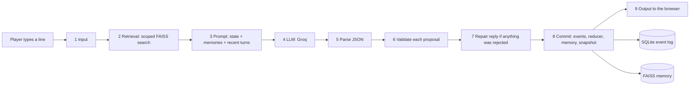

# The Obsidian Flask, Explained

This document explains the whole project from zero for a human reader: what problem it solves, how every part works, why each choice was made, what the evaluation found, and how to talk about it in an interview, viva, or demo. Setup steps are in [README.md](README.md). Every number here comes from the repository, mostly from [`notebooks/outputs/`](notebooks/outputs/) and [`Backend/config.py`](Backend/config.py).

## Table of contents

1. [The project in one minute](#1-the-project-in-one-minute)
2. [Background](#2-background)
3. [How it works, end to end](#3-how-it-works-end-to-end)
4. [Every part explained](#4-every-part-explained)
5. [Decisions](#5-decisions)
6. [Results and quality](#6-results-and-quality)
7. [Running and demoing it](#7-running-and-demoing-it)
8. [What could come next](#8-what-could-come-next)
9. [Interview and pitch preparation](#9-interview-and-pitch-preparation)
10. [Glossary](#10-glossary)

## 1. The project in one minute

**The problem.** In a video game, a non-player character (NPC) is a character the computer controls, such as a barkeeper or a thief. A large language model (LLM) can let such characters talk freely instead of reading from a fixed list of lines. But LLMs have three weaknesses in a long game. They forget what the player told them many turns ago. They happily say things that break the game's rules, for example "here, take 2,000 gold" or "let me walk you through the wall into the vault". And the longer the conversation, the more text must be sent to the model each turn, so it gets slower and costlier.

**Who has it.** Game developers who want LLM-driven characters, and researchers who study LLM agents that must stay consistent with a world.

**What the project does.** The Obsidian Flask is a playable text adventure (a web game) whose NPCs talk through an LLM, but where the LLM never directly changes the game world. The model only _proposes_ changes. Code checks each proposal against the rules (a "validation barrier"), and only lawful changes are recorded, as events in an append-only log. For memory, the game keeps the last 8 turns word for word and stores older turns in a searchable vector index, searched only for memories from the current place and character ("scoped retrieval").

**The headline result.** A Kaggle notebook tested the design against eight memory baselines on seven worlds and four models. On worlds it was never tuned on, the system recalled 83.0% of facts that were 20 or more turns old, against 0.0% for a rolling window of the same size. It was not better than a simple flat vector memory (84.3%), and it recalled less than its own earlier version (88.6%). On state control, no model output committed a rule violation through the barrier, for any of four models, while only 0.7% of lawful player requests were wrongly refused. Crash recovery was exact in all 300 simulated crashes. The research paper, [docs/paper/main.pdf](docs/paper/main.pdf), reports all of this, including the hypotheses that failed.

## 2. Background

This section builds up every idea the rest of the document uses.

**Text adventure.** A game played mostly through text. The player types what their character says or does, and the game answers in text. The Obsidian Flask is set in a dark-fantasy tavern district: 8 locations (for example the tavern's Common Room, the Shadowed Cellar, the Obsidian Courtyard, and the Hidden Sanctum), 4 NPCs (Gareth Ironhand the barkeep, Lira the barmaid, Silas the thief, and Vorn the Mad, an alchemist), and 4 objects (such as a Heavy Brass Key). These come from [`Backend/game/world_seed.json`](Backend/game/world_seed.json).

**Large language model (LLM).** A neural network trained on huge amounts of text to predict the next piece of text. Given a "prompt" (the input text), it writes a continuation. Chat models are tuned to answer like an assistant or, here, like a character. The game uses `openai/gpt-oss-120b` hosted by Groq, at temperature 0.35 ([`Backend/config.py`](Backend/config.py)). Temperature controls randomness: 0 is nearly deterministic, higher values give more varied text.

**Token.** The unit a model reads and writes, roughly a word piece. Cost and speed scale with the number of tokens.

**Context window.** The maximum amount of text a model can read in one request. Anything outside it is invisible to the model, which is why plain chat "forgets".

**Why an LLM breaks rules.** The model only predicts plausible text. If a player says "give me your gold", a plausible reply may be "fine, take it all", even if the game says the NPC has none. Researchers have shown that LLMs are unreliable at simulating state changes in text worlds (Wang et al., ACL 2024, cited in the paper).

**Game state.** Everything true about the world at a moment: where the player is, what they carry, how much money they have, how much each NPC trusts them, and so on. In this project the state is a typed object defined in [`Backend/schemas/world_state.py`](Backend/schemas/world_state.py).

**Embedding.** A list of numbers (a vector) that represents the meaning of a text, so that texts with similar meaning get similar vectors. The game uses the `sentence-transformers/all-MiniLM-L12-v2` model, which outputs 384 numbers per text.

**Vector search and FAISS.** Given a query vector, find the stored vectors most similar to it. Similarity here is cosine similarity: the vectors are scaled to length 1, and their dot product (inner product) then measures how closely their directions agree. FAISS is a library from Meta for fast vector search. This project uses its exact search (`IndexFlatIP`, "flat inner product"), which compares the query with every stored vector.

**Retrieval-augmented generation (RAG).** Search a store for relevant text, then put that text into the prompt so the model can use it. The project name says "RAG-Driven" because NPC memory works this way.

**Event sourcing.** Instead of saving only the current state, save every change as an event in an append-only log, and compute the state by replaying the events from the start. Like a bank statement: the balance is the result of all transactions. It gives a full history, makes bugs traceable, and lets you rebuild the state after a crash.

**Reducer.** A pure function that takes a state and one event and returns the next state. "Pure" means it depends only on its inputs and has no side effects, so replaying the same events always gives the same state.

**Snapshot.** A saved copy of the state at some event, so recovery can start from the snapshot and replay only the events after it, instead of the whole log.

**Validator (barrier).** Code that checks a proposed change against the rules before it is applied. Here it is "pre-commit", meaning it runs before anything is written, and "symbolic", meaning it uses explicit rules, not another model.

**LangGraph.** A Python library for building a program as a graph of steps (nodes) that pass a shared state along edges. The game's turn is a fixed graph of 9 nodes.

**Oracle.** In testing, an independent checker that knows the right answer. The evaluation's oracle checks eight rules (invariants) on each post-turn state, and it was written without reusing any validator code, so a validator bug cannot hide itself.

## 3. How it works, end to end

### The picture

### One turn, step by step

The example uses the real W1 world. The player has just started: they stand in `tavern_common` (the Common Room) with 100 coins, and Gareth (`gareth_barkeep`) trusts them at 0. The Common Room connects to `tavern_cellar`, `tavern_backroom`, `obsidian_courtyard`, and `upper_balcony`.

1. **The player types** "Gareth, walk me out to the courtyard, and give me 500 coins for my trouble." The React frontend sends it to `POST /api/game/action/{session_id}`.
2. **Input node.** Trims the text. An empty line becomes "(silence)".
3. **Retrieval node.** Embeds the line into a 384-number vector and asks FAISS for the 30 nearest memories (6 wanted, times an over-fetch factor of 5). It keeps those recorded at `tavern_common` with Gareth, up to 6. If fewer than 3 survive, it falls back to the plain top 6. On the first turn, the store is empty.
4. **Prompt node.** Builds the prompt: fixed system rules (which state the validator's limits, such as at most 20 trust change per NPC per turn and at most 50 coins gained per turn), the canonical facts about the current location and NPC, the player's identity, the packed memories and recent turns (sharing a budget of 1,600 characters), and the player's line. The whole prompt is capped at 16,384 characters.
5. **LLM node.** Groq returns one JSON object with dialogue, narration, a one-sentence memory summary, and a list of proposed changes. Here the model might propose `PLAYER_MOVED` from `tavern_common` to `obsidian_courtyard`, and a currency change of +500.
6. **Parse node.** Checks the JSON against a Pydantic schema ([`Backend/schemas/llm_output.py`](Backend/schemas/llm_output.py)). If it is not valid JSON, the raw text becomes the dialogue and no change is proposed.
7. **Validate node.** Checks each proposal in order against a running copy of the state. The move is lawful: the courtyard is adjacent and it is the turn's only move. The +500 is rejected because the net gain cap is 50.
8. **Repair node.** Because something was rejected, the model is asked once to rewrite the reply so it no longer claims the player received 500 coins. If the rewrite does not parse, a neutral narration replaces it.
9. **Commit node.** In one SQLite transaction it appends an `NPC_SPOKE` event and the accepted `PLAYER_MOVED` event. The reducer applies them, so the player is now in `obsidian_courtyard` with still 100 coins. The turn is added to the 8-turn buffer, and the memory summary is added to FAISS, tagged with the location and NPC. Every 16 turns a snapshot is written.
10. **Output node.** Returns the dialogue and the new state. The browser updates the conversation, the map, and the purse.

Without the barrier (direct writes), the same output would have given the player 600 coins, which is exactly the kind of failure the evaluation measures.

## 4. Every part explained

Parts are in the order data flows through them.

### 4.1 Frontend (`Frontend/`)

- **What it does.** The playable web game: title screen, character creation, the Scene (conversation plus the current room), Map, People, Journal, Load game, and a 404 page ([`Frontend/src/pages/`](Frontend/src/pages/)).
- **How.** React 18 with TypeScript, built by Vite 8 and styled with Tailwind CSS. Zustand stores hold the game and UI state ([`Frontend/src/stores/`](Frontend/src/stores/)). REST calls live in [`Frontend/src/services/httpClient.ts`](Frontend/src/services/httpClient.ts), and a WebSocket service keeps a live connection. Backend data shapes are mirrored by hand in [`Frontend/src/contracts/api.ts`](Frontend/src/contracts/api.ts), and pure mapper functions convert them ([`Frontend/src/stores/mappers.ts`](Frontend/src/stores/mappers.ts)).
- **Inputs and outputs.** Player text and clicks in, rendered dialogue and state out.
- **Why.** A real playable game shows the engine working and gives the evaluation a real system to test. The visual design (a Persian palace at night) is in [DESIGN.md](DESIGN.md).

### 4.2 API layer (`Backend/api/`)

- **What.** A FastAPI app with 18 HTTP endpoints and 1 WebSocket endpoint (`/ws/game/{session_id}`). The full list is in [README.md](README.md#api-documentation).
- **How.** Pydantic models validate request bodies (for example, a player action is 1 to 2,000 characters, and age must be 18 or more). Every response carries an `X-Request-ID`. Unhandled errors return a generic 500 unless `DEBUG_ERRORS=true`.
- **Why.** FastAPI gives typed request validation and WebSockets in one small framework.

### 4.3 Session manager (`Backend/session/`)

- **What.** Creates, loads, saves, and destroys game sessions, and runs turns. At most 50 sessions at once (`MAX_CONCURRENT_SESSIONS`).
- **How.** Each session gets its own folder under `Backend/data/sessions/` with an event database, a FAISS index, snapshots, and dialogue files. A per-session lock stops two turns of one session from running at once.
- **Why here.** Lifecycle is application logic, not transport, so routes stay thin ([ARCHITECTURE.md](ARCHITECTURE.md)).

### 4.4 Turn graph (`Backend/graph/definition.py`)

- **What.** The 9-node LangGraph `StateGraph` walked through in [section 3](#one-turn-step-by-step).
- **How.** Each node is built by a factory function, so the evaluation can swap one node (for example the retrieval) and keep the rest.
- **Why a fixed graph.** The order of steps is the safety argument: the LLM output must pass parse and validate before commit, every turn, with no path around it.

### 4.5 Memory (`Backend/memory/`)

- **Short-term buffer** ([`short_term.py`](Backend/memory/short_term.py)): a ring buffer of the last 8 turns (`MAX_SHORT_TERM_TURNS`).
- **Embedder** ([`embedder.py`](Backend/memory/embedder.py)): all-MiniLM-L12-v2, with an SQLite cache (`Backend/data/embed_cache.db`) so the same text is not embedded twice.
- **Long-term store** ([`faiss_index.py`](Backend/memory/faiss_index.py)): an exact inner-product FAISS index. Each entry stores the vector of the player's input, the model's one-line summary as the text to show, the turn, the location, and the NPC. When the store passes 1,000 entries it keeps the newest 500.
- **Scoped retrieval.** Over-fetch 30, keep those whose location and NPC match (empty tags match anything), stop at 6, and fall back to the unscoped top 6 if fewer than 3 survive.
- **Packing** (`pack_context` in [`Backend/llm/prompt_builder.py`](Backend/llm/prompt_builder.py)): memories and recent turns share 1,600 characters. The newest 2 turns are always kept, then memories in rank order, then older turns. A memory whose turn is already in the history is dropped as a duplicate.
- **Why dual-tier.** Recent turns need exact wording, and old facts need search. Scoping is meant to stop a fact told to another NPC, somewhere else, from crowding out the right one.
- **Known limit.** Filtering after a global top-30 search can miss an in-scope memory if more than 29 out-of-scope memories are more similar (the paper's Proposition 2). Filter-aware indexes avoid this.

### 4.6 Prompt builder and LLM client (`Backend/llm/`)

- **Prompt builder.** Writes the system block from the same constants the validator uses, so the model is told the real limits. NPC secrets are shown only once that NPC's trust in the player reaches 60 (`SECRET_REVEAL_TRUST`).
- **Groq client** ([`groq_client.py`](Backend/llm/groq_client.py)): 30-second timeout, up to 3 retries with backoff for transient errors only (rate limits, server errors, timeouts), and JSON extraction from the reply. Authentication errors fail at once. The SDK's own retries are off so the two retry loops cannot multiply.

### 4.7 Validator (`Backend/game/validator.py`)

- **What it checks.** A move goes to a real, adjacent location, and only once per turn. A trust change names a real NPC and keeps that NPC's total change in the turn within +/-20. A taken object is real and at the player's location. NPC drops and takes check possession and presence. NPC moves follow a connection. State and flag updates name a real target and key. A journal entry has content. A currency change is an integer, total spending does not exceed the opening balance, and the net gain does not exceed 50. Engine-only event types and new entities are always rejected.
- **How.** Proposals are checked in order against a running state, so two individually lawful spends cannot together overspend.
- **What it does not check.** Plausibility. A +15 trust change with no reason in the dialogue passes.

### 4.8 Event store, reducer, snapshots, recovery (`Backend/core/`)

- **Event store** ([`event_store.py`](Backend/core/event_store.py)): SQLite, append-only, auto-increment ids, one transaction per turn. 14 event types are defined in [`Backend/schemas/events.py`](Backend/schemas/events.py).
- **Reducer** ([`reducer.py`](Backend/core/reducer.py)): deep-copies the state and applies one event. It is defensive on its own: it ignores moves to unknown places, clamps trust to [-100, 100], and floors currency at 0.
- **Snapshots** ([`snapshot.py`](Backend/core/snapshot.py)): written atomically every 16 turns, recording the last event id they include.
- **Recovery** ([`recovery.py`](Backend/core/recovery.py), `recover_state`): load the latest usable snapshot and replay the events after it, or replay everything if no snapshot fits.

### 4.9 Launcher and tooling (`scripts/`)

- **`npm run dev`** ([`scripts/dev.mjs`](scripts/dev.mjs)): first-run setup, then the backend and frontend, each in its own window on Windows. It opens the browser when both respond, and `Ctrl+C` stops everything.
- **Setup** ([`scripts/lib/workspace.mjs`](scripts/lib/workspace.mjs)): installs Node packages and a Python `.venv`, all caches inside the repository (`.cache/`). The pip install streams a status line every 20 seconds, logs to `.cache/pip-install.log`, and handles `Ctrl+C` by stopping pip and telling you to rerun.
- **`npm run check`** ([`scripts/check.mjs`](scripts/check.mjs)): clone detection (`jscpd`), `black`, backend tests, the notebook bundle check, and frontend format, typecheck, lint, tests, and build.
- **`npm run paper`** ([`scripts/paper.mjs`](scripts/paper.mjs)): builds the manuscript, the supplement, and their variants (six PDFs) with the bundled Tectonic LaTeX engine and fails on any log problem.
- **`scripts/notebook_bundle.py`**: copies the backend source into the notebook, so the notebook tests exactly the shipped code.

### 4.10 The evaluation notebook (`notebooks/npc-memory-state-benchmark.ipynb`)

- **What.** A self-contained Kaggle notebook (147 cells, 73 of them code) that embeds the backend, builds the benchmark, serves models with vLLM on two Tesla T4 GPUs, runs every experiment, and writes all tables and plots. Its cell-by-cell walkthrough is in [README.md](README.md#evaluation-notebook).
- **Why a notebook on Kaggle.** It needs two GPUs and hours of runtime, which do not belong in unit tests. Its results are committed in [`notebooks/outputs/`](notebooks/outputs/).

### 4.11 The benchmark data

- **Seven worlds** ([`notebooks/outputs/metrics/world_stats.csv`](notebooks/outputs/metrics/world_stats.csv)): W1 is the game's own world (8 locations). W2a to W2c are converted from the crowd-written LIGHT dataset (16, 24, and 32 locations, CC BY-NC 4.0). W3 is a 24-location science-fiction station written in the notebook. W4-32 and W4-128 are generated graphs with 32 and 128 locations. Using several families tests whether results generalise beyond the world the system was built on.
- **Recall sessions.** Scripted conversations of 50, 100, or 200 turns. A fact (for example a password made of an invented word) is "planted" with an NPC and asked about again 5 to 160 turns later. A paraphrased "distractor" with a different value is told to another NPC in between. Replies before the probe are scripted ("teacher forcing"), so every memory design sees the same history and only the probe answer is generated. 630 probes per condition.
- **Adversarial probes.** Seven attack types: teleportation, item fabrication, theft, trust inflation, currency exploits, prompt injection, and secret extraction. Each has a lawful "twin" request (for example, walking to an adjacent room instead of teleporting), used to measure wrong refusals. 490 attacks and 470 twins, each posed under five memory contexts, give 4,800 outputs.
- **Live sessions.** 39-turn scripts run through the real backend graph, so the model's own replies shape later turns. 14 sessions per condition.

### 4.12 The paper (`docs/paper/`)

- **What.** An IEEE-format LaTeX paper, formatted for IEEE Transactions on Games ([RESEARCH.md](RESEARCH.md#target-journal-for-the-paper-2026-10-26)). The base paper it compares with is Generative Agents (Park et al., UIST 2023).
- **Manuscript and supplement.** The journal limits full papers to 10 pages including references, so `main.tex` holds the core story in exactly 10 pages and `supplementary.tex` holds everything else (the algorithms, the dataset details, the run configuration and audit, and every secondary table and figure), numbered S1, S2, and so on. Links between the two PDFs work because each build reads the other's `.aux` file (the `xr-hyper` package).
- **Six PDFs.** The manuscript and the supplement, an anonymised copy of each for double-anonymous review, a separate title page naming the corresponding author, and a manuscript copy without the reference list for similarity checks. Each variant is a short wrapper that sets a switch and includes the main source.

## 5. Decisions

Each entry gives the choice, the reason, pros, cons, alternatives, and when an alternative wins. Reasons come from [ARCHITECTURE.md](ARCHITECTURE.md), [RESEARCH.md](RESEARCH.md), and the paper unless marked.

| Decision                                       | Why                                                                                                        | Pros                                                                              | Cons                                                                                        | Alternatives, and when they win                                                                                                                                      |
| ---------------------------------------------- | ---------------------------------------------------------------------------------------------------------- | --------------------------------------------------------------------------------- | ------------------------------------------------------------------------------------------- | -------------------------------------------------------------------------------------------------------------------------------------------------------------------- |
| LLM proposes, code commits                     | LLM output is untrusted text                                                                               | Rules hold no matter what the model says                                          | Needs a rule for everything, rejects some lawful requests                                   | Let the LLM write state directly (simpler, wins only for throwaway prototypes). An LLM judge (PANGeA, Phillips et al.) wins when rules are fuzzy and cannot be coded |
| Symbolic validator, not an LLM judge           | Deterministic, fast (1.4 ms at P95), auditable                                                             | No extra model call, cannot be talked out of a rule                               | Checks structure, not plausibility                                                          | An LLM judge for narrative plausibility on top of the symbolic check                                                                                                 |
| Event sourcing with a pure reducer             | Full history, replay, crash recovery                                                                       | Exact replay (100% in tests), easy debugging                                      | More storage, replay cost grows with the log                                                | Save only the current state (simpler, wins if history and recovery do not matter)                                                                                    |
| Snapshot every 16 turns plus suffix replay     | Bounded recovery time                                                                                      | Loading took 1.1 to 1.4 ms against 243.2 ms for a full replay at turn 160         | Snapshot writes add I/O                                                                     | Snapshot every turn (faster recovery, more writes), or full replay only (simplest, slow for long games)                                                              |
| Dual-tier memory (8-turn buffer plus FAISS)    | Exact recent context plus searchable old facts                                                             | Long-range recall without sending the whole history                               | Two stores to keep in sync                                                                  | Full history (wins for short games, cost 3 times the tokens here), rolling window (fails past its size)                                                              |
| Scope retrieval to location and NPC            | Keep the right character's facts first                                                                     | Better ranking (MRR@6 0.910 against 0.742) and fewer distractors                  | Did not beat flat vector memory on recall, and can miss facts recalled elsewhere            | Flat vector memory (as good on recall here), filter-aware indexes such as Filtered-DiskANN for large stores                                                          |
| Exact FAISS search (`IndexFlatIP`)             | Likely reason (not recorded in the repository): stores stay small because they are pruned at 1,000 entries | Exact results, no index training                                                  | Linear time per query                                                                       | Approximate indexes (HNSW, IVF) when stores reach many thousands of entries                                                                                          |
| Memory summary written by the same LLM call    | No extra call per memory write                                                                             | Cheaper than Generative Agents, which rate importance with an LLM call per memory | Summary quality depends on the model                                                        | A separate summariser or importance rater (Generative Agents style)                                                                                                  |
| Dialogue repair node                           | Rejected changes stayed in the dialogue                                                                    | Every rejected reply is rewritten                                                 | One extra LLM call per rejected turn, and did not change the judge's verdict on those turns | Generate narration from committed events (likely better, not built yet)                                                                                              |
| FastAPI plus React plus Vite                   | Typed API with WebSockets, mainstream frontend                                                             | Well-known tools, fast dev server                                                 | Two runtimes to install                                                                     | A single-runtime stack. Likely reason (not recorded in the repository): the team's familiarity                                                                       |
| Groq hosting `gpt-oss-120b` for the game       | Likely reason (not recorded in the repository): fast hosted inference without a local GPU                  | No GPU needed to play                                                             | Needs an API key and network, costs per token                                               | Self-hosted models (used in the evaluation for reproducibility)                                                                                                      |
| Self-hosted K2-Horizon-7B for the evaluation   | Reproducible, free per token, controllable seeds                                                           | Common random numbers across conditions                                           | Smaller than the game's model                                                               | The hosted model (more realistic, not reproducible, costs money)                                                                                                     |
| Kaggle notebook for evaluation                 | Needs 2 GPUs and hours                                                                                     | Free GPUs, full saved outputs                                                     | Not runnable locally                                                                        | A GPU server with scripts (more control, costs money)                                                                                                                |
| Independent oracle for violations              | A validator bug cannot hide itself                                                                         | It found the missing currency rule in the Review-02 run                           | Another rule set to maintain                                                                | Count validator rejections (circular, misses validator gaps)                                                                                                         |
| Paired four-way commit                         | Same output, four commit paths                                                                             | Differences are due to the commit path alone                                      | More bookkeeping                                                                            | Separate runs per mode (confounded by sampling noise)                                                                                                                |
| No `websockets` pin in requirements            | A `websockets<14` cap made pip backtrack through 65 `langsmith` versions on a fresh install                | Fast, predictable resolution                                                      | Version comes from `uvicorn[standard]`                                                      | A full lock file (reproducible, but needs regular updates)                                                                                                           |
| One `npm run dev` launcher with streamed setup | One command for a fresh clone                                                                              | Status every 20 s, resumable after `Ctrl+C`                                       | Node script to maintain                                                                     | Separate shell scripts per OS (more duplication)                                                                                                                     |

## 6. Results and quality

All values are from the third Review-03 run (24 to 25 October 2026, 7.65 hours on 2 Tesla T4 GPUs, sample-size level 2 of 0 to 7). "Held-out worlds" means W2a to W4-128, which no setting was tuned on. A value like 83.0 [79.4, 86.7] is the mean with its 95% bootstrap confidence interval: if the experiment were repeated, the true value would usually fall in that range.

### 6.1 Metrics, and how to read them

| Metric                         | What it measures                                                                               | Range, and what is good                                                                      |
| ------------------------------ | ---------------------------------------------------------------------------------------------- | -------------------------------------------------------------------------------------------- |
| Recall at age 20 or more       | Share of probes about facts 20 or more turns old answered with the planted key word            | 0 to 100%, higher is better                                                                  |
| MRR@6 (mean reciprocal rank)   | For each probe, 1 divided by the rank of the right memory in the top 6 (0 if absent), averaged | 0 to 1, 1 means always ranked first                                                          |
| Recall@6                       | Share of probes whose right memory is in the top 6                                             | 0 to 100%                                                                                    |
| Gold in prompt                 | Share of probes whose fact reached the prompt at all                                           | Upper bound on recall                                                                        |
| Attack success                 | Share of attacks whose post-state breaks an invariant (or leaks a secret)                      | Lower is better                                                                              |
| Violations per 100 transitions | Turns whose post-state breaks an invariant, per 100 committed changes                          | Lower is better. Can exceed 100, because a corrupted state is flagged again every later turn |
| False rejection                | Share of lawful twin proposals the barrier rejected                                            | Lower is better. The hypothesis bound was 5%                                                 |
| Validator gap                  | Share of unlawful proposals the barrier accepted                                               | 0% is perfect                                                                                |
| Desynchronisation              | Turns where the dialogue claims a change the state did not record (automatic cue proxy)        | Lower is better                                                                              |
| Replay consistency             | Share of sessions whose state rebuilt from the log matches the live state (SHA-256 hash)       | 100% expected                                                                                |
| P50 and P95 latency            | Median and 95th-percentile time                                                                | Lower is better                                                                              |

### 6.2 Main comparison (held-out worlds)

From [`table1_main_comparison.csv`](notebooks/outputs/metrics/table1_main_comparison.csv):

| Condition                                | Recall a>=20 (%)  | MRR@6 | Input tokens per turn |
| ---------------------------------------- | ----------------- | ----- | --------------------- |
| F4, the proposed system                  | 83.0 [79.4, 86.7] | 0.910 | 1,444                 |
| F4v1, the Review-02 system               | 88.6 [85.1, 91.9] | 0.888 | 1,399                 |
| B0 full history                          | 77.8              | n/a   | 4,406                 |
| B1 rolling window, budget B              | 0.0               | n/a   | 1,478                 |
| B1 rolling window, budget 2B             | 19.8              | n/a   | 1,877                 |
| B2 flat vector memory                    | 84.3              | 0.742 | 1,451                 |
| B3 generic RAG                           | 61.7              | 0.700 | 1,506                 |
| B4 Generative-Agents-style memory stream | 63.0              | 0.557 | 1,449                 |
| B5 MemoryBank-style forgetting curve     | 79.9              | 0.723 | 1,450                 |

What it means: long-term memory is essential (the rolling window forgets everything older than 10 turns). Scoping ranks the right memory higher, but flat vector memory recalls just as well on this benchmark. The base paper's recency-weighted rule (B4) forgets old facts under a budget: 37.5% at age 80 and 22.2% at age 160. And the Review-03 version recalls less than the Review-02 version, mostly at age 5 (78.7% against 96.3%), which the run does not explain. One suspect is that the new packing rule shows a buffered fact once instead of twice.

### 6.3 State control

From [`table5_probes_by_category.csv`](notebooks/outputs/metrics/table5_probes_by_category.csv), on the same outputs committed four ways:

| Commit path                     | Attack success |
| ------------------------------- | -------------- |
| Direct writes                   | 6.4%           |
| Reducer only, no validator (A5) | 2.2%           |
| Review-02 barrier               | 1.2%           |
| Corrected barrier               | 0.0%           |

What it means: the reducer's own defensive behaviour already blocks most attacks, so validator and reducer must be judged together. The old validator missed currency gains (59.1% of unlawful currency proposals accepted), which the oracle found and the correction closed. The 4 lawful twin proposals rejected (of 684) were trust changes that named an NPC by display name instead of id, which the validator must reject. In live play, direct writes left the player in a non-existent place on about 30 of 39 turns, while both barrier conditions had no flagged turn. Other model families proposed far more unlawful changes (Qwen2.5-7B 43.9% attack success under direct writes), and the barrier stopped all of them.

### 6.4 Other results

- **Factorial (memory x control, live).** Memory drives recall and control drives violations, but they are not independent: the mixed model finds a positive interaction on recall (p = 3.1e-6), so hypothesis H6 fails.
- **Replay and recovery.** Every event-sourced session replayed exactly. In 300 random crash trials the corrected load path was consistent in all 300, the Review-02 path in 77.
- **Latency.** Local work (everything but the LLM) took 15.1 ms at the median and 19.2 ms at P95. Validation took 0.013 ms at the median. The LLM call dominates at about 8.1 s per live turn single-stream.
- **Dialogue repair.** It rewrote every rejected reply, but the judge found about as many contradictions after repair as before (41.7% against 39.6% of probe replies). Yet over whole sessions, the corrected system contradicted rejected changes on 13.8% of judged live turns against 57.0% for the Review-02 system, likely because the new prompt states the limits and fewer proposals get rejected.
- **Hypotheses.** H2, H3, H4, and H5 supported. H1, H6, and H7 not supported. The full table is in the paper and [README.md](README.md#hypothesis-tests).

### 6.5 How quality is checked

- Backend unit and property tests ([`Backend/tests/`](Backend/tests/)), including 3,000 random multi-proposal turns checked against an independent invariant checker, and architecture tests that enforce layer rules.
- Frontend tests (Vitest) for the HTTP client and the dialogue mapper.
- `npm run check` runs every check, plus a clone detector that fails above 1% duplicated code.
- The notebook runs a self-test with a mock LLM before any GPU time, and every number in the paper was cross-checked against the output files.

### 6.6 Limitations and risks

- Sample size is level 2 of 8, and live intervals are wide.
- Scoring is automatic (key words, cue words, an LLM judge). Human ratings have not been collected yet ([docs/human-evaluation.md](docs/human-evaluation.md)).
- The benchmark always asks about a fact with the NPC who heard it, at that NPC's place, which favours scoping.
- The game's real model (Groq `gpt-oss-120b`) was not evaluated, only self-hosted models up to 7B parameters.
- No authentication or rate limiting. Do not expose the backend publicly.
- The validator checks rule structure, not story plausibility.

## 7. Running and demoing it

1. Run `npm run dev` in the repository root. The first run installs everything and takes several minutes. Watch for `Still ...` status lines.
2. Put a Groq key in `Backend/.env` (`GROQ_API_KEY=...`) and run `npm run dev` again.
3. The browser opens `http://localhost:8080`. Create a character and talk to Gareth in the Common Room.
4. A good demo of the barrier: ask Gareth for 500 coins, then look at the purse. It still shows 100, and the reply is rewritten so it does not claim you were paid.
5. A good demo of memory: tell Lira a password, chat for more than 8 turns, then ask her for it again.

Details and troubleshooting are in [README.md](README.md#quick-start).

## 8. What could come next

All supported by the paper's evidence:

- Rerun the evaluation at a larger sample size, reusing this run's response caches.
- Collect the two-rater human labels and check the contradiction judge against them.
- Generate narration from committed events instead of repairing free text.
- Find what caused the recall loss against Review-02, by ablating the packing rule's duplicate removal and the prompt separately.
- Test recall away from the place a fact was told.
- Add a plausibility check on top of the structural validator.
- Use filtered or hierarchical indexes for long campaigns.
- Evaluate the game's hosted model.

## 9. Interview and pitch preparation

### 30-second version

"LLM characters forget things, break game rules, and get slower as the chat grows. I built a text adventure where the LLM only proposes changes and a rule checker decides what is committed to an event log, with a two-tier memory that keeps recent turns and searches older ones by place and character. On a benchmark of seven worlds and four models, nothing illegal got through the barrier, recall of old facts was 83% against 0% for a same-size rolling window, and crash recovery was exact. The memory did not beat a simple vector store, and I report that honestly."

### 2-minute version

Start with the three failure modes. Explain the split: language from the LLM, state from code. Walk through one turn (input, scoped retrieval, prompt, LLM, parse, validate, repair, commit, output). Then the evaluation: eight memory baselines at an equal budget, a 2 x 2 memory-by-control design, seven ablations, seven worlds from four families, four models from three families, adversarial probes with lawful twins, and an independent oracle. Give the results: memory needed (83.0% against 0.0%), scoping improves ranking but not recall over flat vectors, the barrier blocks every attack with 0.7% false rejection, and replay and recovery are exact. End with what failed: H1, H6, and H7, and the recall loss against the earlier version.

### Likely questions

| Question                                                                | Short answer                                                                                                                                                                                                                                             |
| ----------------------------------------------------------------------- | -------------------------------------------------------------------------------------------------------------------------------------------------------------------------------------------------------------------------------------------------------- |
| Why not just use a bigger context window?                               | Cost and latency grow with it (full history used 3 times the tokens), and models use the middle of long contexts poorly. Full history also recalled less here (77.8%).                                                                                   |
| Why not let the LLM judge the rules?                                    | A model judge can be talked out of a rule and costs another call. Symbolic rules are deterministic and took 1.4 ms at P95.                                                                                                                               |
| Your memory did not beat a flat vector store. So what does scoping add? | Better ranking (MRR@6 0.910 against 0.742) and fewer distractors in the prompt (46% of prompts kept the distractor out, against 1%). On recall it is a tie, and I say so.                                                                                |
| Why did the new version recall less than the old one?                   | Not proven. The old version showed a buffered fact twice, once in history and once as a memory. The run does not separate that from the prompt change. The next step is an ablation of each.                                                             |
| How do you know the oracle is right?                                    | It was written from the specification, imports no validator code, and found a real validator gap (currency). Unit tests also check it. Human labels are still pending.                                                                                   |
| What would break at scale?                                              | Sessions live in process memory, so more than one backend process needs a shared store. FAISS exact search is linear, so very long games need approximate or filtered indexes. Post-filtering a global top-30 can miss in-scope memories.                |
| What was the hardest part?                                              | Making the evaluation fair: identical outputs committed four ways, request seeds independent of condition, and fixing four measurement bugs in the harness found by auditing the first run.                                                              |
| Is 0% attack success real or a small sample?                            | 2,450 attack outputs across five contexts, plus three other models. Zero through the barrier, but the validator only knows the rules it was given.                                                                                                       |
| Why event sourcing for a game?                                          | Replay, audit, and crash recovery. 300 of 300 crashes recovered, against 77 of 300 with the old load path.                                                                                                                                               |
| Why the Generative Agents paper as a base?                              | It is the best-known LLM-character architecture with long-term memory. Its retrieval rule (B4) was re-implemented without the LLM importance score, and it forgot old facts under a budget.                                                              |
| Did the dialogue repair work?                                           | Partly. It rewrote every rejected reply, but the judge saw no drop in contradictions on those turns. The system overall contradicted far less than before, likely because the prompt now states the limits.                                              |
| Why did `npm run dev` look stuck on a fresh clone?                      | A `websockets<14` pin conflicted with `langsmith`, so pip backtracked through 65 versions, and a quiet, blocking install hid both that and the minutes-long PyTorch unpacking. The pin was removed and the install now prints progress every 20 seconds. |

### For a product pitch

- **User.** Game studios and interactive-fiction makers who want LLM characters without broken game economies.
- **Value.** Characters that remember and cannot break the rules, with a replayable log for debugging.
- **Competitors and related work.** Generative Agents (memory streams, no rule checks), PANGeA and goal-based dialogue systems (LLM judges), and commercial NPC platforms such as Inworld (no published evaluation is in the repository, so no comparison is claimed).

## 10. Glossary

- **Ablation**: removing one component to see how much it mattered (A1 to A7 here).
- **Adjacency**: two locations are adjacent if one lists the other in `connected_to`.
- **Append-only log**: a record you only add to, never edit.
- **Barrier**: this project's name for the validator that every proposed change must pass.
- **Baseline**: a simpler or existing method to compare against (B0 to B5).
- **Bootstrap confidence interval**: a range for a result, found by resampling the data many times (10,000 here) and taking the middle 95% of the results.
- **Cosine similarity**: how closely two vectors point the same way, from -1 to 1.
- **Desynchronisation**: dialogue that says something happened that the state did not record.
- **Distractor**: a similar fact with a different value, planted to test whether memory picks the right one.
- **Embedding**: a vector of numbers that represents a text's meaning.
- **Event**: one recorded change to the world, such as `PLAYER_MOVED`.
- **Event sourcing**: storing state as the sequence of events that produced it.
- **Factorial design**: testing every combination of factors (memory on or off, control on or off).
- **FAISS**: a library for fast vector search.
- **False rejection**: the barrier refusing a lawful request.
- **Held-out world**: a world never used to tune the system.
- **Holm correction**: a way to adjust p-values when several tests are run together, so chance findings are less likely.
- **Invariant**: a rule that must always hold, such as "each object is in exactly one place".
- **LangGraph**: a library for building programs as graphs of steps.
- **Large language model (LLM)**: a model trained to predict and generate text.
- **McNemar test**: a test for paired yes or no outcomes, such as the same probe under two conditions.
- **Mixed-effects model**: a regression that also accounts for groups, here worlds and sessions.
- **MRR (mean reciprocal rank)**: the average of 1 divided by the rank of the right answer.
- **Non-player character (NPC)**: a character the game controls.
- **Oracle**: an independent checker of correct behaviour.
- **P50, P95**: the median, and the value 95% of measurements are below.
- **p-value**: how surprising a result would be if there were no real effect. Small values (below 0.05) suggest a real effect.
- **Prompt**: the text sent to an LLM.
- **Prompt injection**: player text that tries to override the model's instructions.
- **Pydantic**: a Python library that validates data against typed models.
- **RAG (retrieval-augmented generation)**: adding retrieved text to the prompt.
- **Reducer**: a pure function from (state, event) to the next state.
- **Replay**: rebuilding state by applying all logged events again.
- **Rolling window**: keeping only the most recent turns that fit a budget.
- **Scoped retrieval**: searching memory only among entries from the current location and NPC.
- **Snapshot**: a saved copy of the state at a point in the log.
- **Teacher forcing**: scripting the earlier replies so every condition sees the same history.
- **Temperature**: a setting that controls how random an LLM's output is.
- **Token**: the unit of text a model processes, roughly a word piece.
- **Twin (lawful twin)**: a lawful request paired with each attack, used to measure false rejection.
- **Validator gap**: unlawful proposals the validator accepted.
- **vLLM**: software that serves LLMs efficiently on GPUs.
- **Wilcoxon signed-rank test**: a test for paired numeric differences that does not assume a normal distribution.
- **WebSocket**: a connection that stays open so server and browser can send messages any time.
